# UAV Research Onboarding

*Linux, Git, ROS 2, PX4 and Gazebo, for master&rsquo;s thesis students
at Politecnico di Torino*

This guide teaches the minimum you need to start work in a UAV research
group. It assumes you have never used Linux, Git, ROS 2, PX4 or Gazebo.
It covers only the tools a typical group uses: Ubuntu, ROS 2, PX4
firmware with Gazebo simulation, and a ground station. Isaac Sim will be
added in a later version. Read it once, then use the [First-day
checklist](#first-day-checklist) on your first day.

# Versions

Everything below targets these versions. When the group upgrades, change
this table and check the commands that mention a version.

| Component | Version | Note |
|:---|:---|:---|
| Ubuntu | 24.04 | `lsb_release -a` |
| ROS 2 | Jazzy | docs: [docs.ros.org/en/jazzy](https://docs.ros.org/en/jazzy) |
| PX4 firmware | 1.17 | docs: use the page for 1.17 |
| `px4_msgs` | branch `release/1.17` | must match the firmware |
| Gazebo | Harmonic (`gz`) | as installed by the PX4 setup script |
| Micro XRCE-DDS Agent | as installed in the lab | `MicroXRCEAgent` |
| QGroundControl | current stable | ground station |

# Linux

## The terminal and the filesystem

Almost all work happens in a terminal. You type a command, press Enter,
and read the output. The shell (here `bash` or `zsh`) is the program
that reads your commands.

Linux has one directory tree that starts at `/` (the root). Your own
files live in your home directory, written `~` (for example
`/home/riccardo`). A *path* says where a file is. An *absolute* path
starts with `/` or `~`. A *relative* path starts from the current
directory. The path `.` is the current directory and `..` is its parent.

<figure>
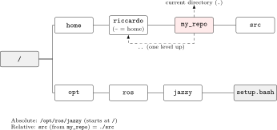
<figcaption>One directory tree, rooted at <code>/</code>. <code>~</code>
is your home directory, <code>.</code> the current directory and
<code>..</code> its parent.</figcaption>
</figure>

``` bash
pwd                       # print the current directory
ls -l                     # list files, one per line, with details
cd ~/my_repo              # change directory
cd ..                     # go to the parent directory
mkdir -p ws/src           # make a directory (and parents)
cp a.txt b.txt            # copy;   mv a.txt c.txt  moves or renames
rm b.txt                  # delete a file (no recycle bin!)
cat file.txt              # print a file;  less file.txt  to scroll
grep -rn "offboard" src/  # search text in files
man ls                    # manual page of a command (q to quit)
```

Tips: press Tab to complete names. Press the up arrow to recall old
commands. Press Ctrl-R to search your history. File names are case
sensitive.

## Permissions and sudo

Each file has an owner and three permission sets: owner, group, others.
Each set allows read (`r`), write (`w`) and execute (`x`). `ls -l` shows
them, for example `-rwxr-xr-x`. A script must have the execute bit to
run as `./script.sh`.

``` bash
chmod +x script.sh        # make a file executable
sudo apt update           # run one command as administrator
```

Use `sudo` only when a command needs it (installing system packages).
Never run ROS or your own code with `sudo`.

## Environment variables and source

An environment variable is a named string that programs can read. ROS 2
depends on them. Print one with `echo $ROS_DISTRO`. Set one for the
current shell with `export ROS_DOMAIN_ID=7`.

A setup file such as `/opt/ros/jazzy/setup.bash` sets many variables at
once (it extends `PATH`, the list of folders where the shell looks for
programs). You must *source* it, not run it:

``` bash
source /opt/ros/jazzy/setup.bash
```

Sourcing changes only the current terminal. When you open a new terminal
you must source again, or put the line in `~/.bashrc` (read at the start
of every bash terminal). A frequent beginner error is &ldquo;command not
found&rdquo; for `ros2` or `colcon`: you forgot to source.

> [!NOTE]  
> If your shell is `zsh`, source the `.zsh` file instead
> (`/opt/ros/jazzy/setup.zsh`) and put the line in `~/.zshrc`.

> [!TIP]  
> Put the base ROS 2 setup file (`setup.bash` or `setup.zsh`) in your
> shell startup file. Source the overlay of your workspace
> (`install/setup.bash`) only when you work in that workspace
> ([Workspaces and colcon](#workspaces-and-colcon)).

## Installing software with apt

Ubuntu installs system software with `apt`.

``` bash
sudo apt update                        # refresh the package list
sudo apt install git build-essential   # install packages
apt search ros-jazzy-rqt               # search
```

## Processes

Every running program is a process. Press Ctrl-C in a terminal to stop
the program in it. Ctrl-Z suspends it. If a program hangs, or a
simulator stays alive in the background:

``` bash
ps aux | grep -i gz        # find processes whose line contains "gz"
kill 12345                 # ask process 12345 to stop (12345 is the PID)
kill -9 12345              # force it, if the first kill did not work
pkill -f px4               # kill by name pattern
htop                       # live process viewer (q to quit)
```

You will run several programs at once (the simulator, the bridge to PX4,
your own nodes). Use one terminal for each, or a terminal multiplexer
such as `tmux`.

## SSH into the onboard computer

The drone carries a small computer. You log in to it over the network
with SSH.

> [!NOTE]  
> The lab drones are already set up. Read this section for background,
> and use it when you set up new hardware.

``` bash
ssh-keygen -t ed25519              # once: make a key pair
ssh-copy-id user@drone-ip          # copy the public key to the drone
ssh user@drone-ip                  # log in; type "exit" to leave
scp file.txt user@drone-ip:~/      # copy a file to the drone
```

Ask your supervisor for the user name and the IP address of the onboard
computer; they are not written here on purpose. The same key type is
used to push to GitHub ([Git and GitHub](#git-and-github)).

## Editors

Use what you like. Recommended editors:

- [VS Code](https://code.visualstudio.com): the most used in the group.
  Its &ldquo;Remote - SSH&rdquo; extension edits files on the drone.

- [Zed](https://zed.dev): built in Rust, faster.

- [Neovim](https://neovim.io): not beginner friendly.

`nano file` is the simplest terminal editor (Ctrl-O saves, Ctrl-X
exits). If you land in `vim` by accident, press Esc, then type `:q!` and
Enter to leave.

# Git and GitHub

Git records the history of a folder (a *repository*). Each saved state
is a *commit*. GitHub hosts a copy of the repository online and adds
issues and pull requests. Lab repositories are usually private. Ask for
access, add your SSH public key (`~/.ssh/id_ed25519.pub`) in your GitHub
account settings, and test with `ssh -T git@github.com`.

## Daily commands

``` bash
git clone --recursive git@github.com:<owner>/<repo>.git
cd <repo>
git status                  # what changed?
git diff                    # show the changes in detail
git add src/my_node.cpp     # stage a file for the next commit
git commit -m "feat(controller): add acceleration limit"
git push                    # upload your commits
git pull                    # download and merge new commits
git log --oneline -10       # last 10 commits
```

The flow is: edit files, `git add` the ones that belong together,
`git commit` with a message, `git push`. A commit is local until you
push.

<figure>
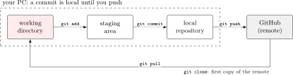
<figcaption><code>git add</code> stages, <code>git commit</code> records
locally, and only <code>git push</code> sends the commits to GitHub.
<code>git pull</code> brings new commits back.</figcaption>
</figure>

Write commit messages as [Conventional
Commits](https://www.conventionalcommits.org):
`<type>(<scope>): <description>`, for example
`feat(controller): add acceleration limit` or
`fix(bridge): correct frame conversion`.

## Branches

A branch is a movable label for a line of commits. Do your work on a
branch, not on `main`.

``` bash
git switch -c feat/12-hover-node       # make and switch to a new branch
git switch main                        # go back
git push -u origin feat/12-hover-node  # first push of a new branch
```

Branch names start with the type (`feat`, `fix`, `docs`, `chore`) and
should contain the issue number.

<figure>
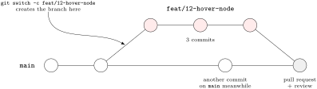
<figcaption><code>git switch -c</code> starts a branch off
<code>main</code>. You commit on it, and a reviewed pull request merges
it back.</figcaption>
</figure>

## Commit messages

Messages follow Conventional Commits: `type(scope): description`.
Examples:

    feat(controller): add tilt limit
    fix(mapper): clamp negative distance
    docs(guide): add ROS 2 section

Use the imperative, lower case, no final period. Add `refs #12` (or
`fixes #12`) at the end of the body to link the commit to an issue.

## Issues and pull requests

An *issue* describes one task. Check the open issues before you start,
and write one for new work. A *pull request* (PR) asks to merge your
branch into `main`. Someone reviews it, then it is merged. If `git pull`
reports a *conflict*, Git marks the clashing lines with `<<<<<<<`; edit
the file to keep what you want, `git add` it, and `git commit`.

## Submodules

A project can include another repository inside it. A typical case in a
PX4 project is the message package:

| Path | Content | Pinned to |
|:---|:---|:---|
| `src/px4_msgs` | PX4 message definitions (public) | branch `release/1.17` (e.g.&nbsp;tag `v1.17.0`) |

A submodule is pinned to one commit. The parent repo does not store the
files of the submodule. It stores the URL (in `.gitmodules`) and one
exact commit hash. When you clone, you get that commit and nothing else,
so everyone builds the same code.

``` bash
# add it once, following the firmware's release branch
git submodule add -b release/1.17 \
  https://github.com/PX4/px4_msgs.git src/px4_msgs

# fresh clone with everything, including nested submodules
git clone --recursive git@github.com:<owner>/<repo>.git

# you cloned without --recursive, or someone bumped a submodule:
git submodule update --init --recursive

git submodule status        # shows the pinned hash of each one
```

A leading `+` in the status means the submodule folder is at a different
commit than the parent pins. A leading `-` means it is not initialised
yet. After a plain `git pull` in the parent, run
`git submodule update --init --recursive` so the folders follow the new
pins.

**Bumping a submodule.** To move `px4_msgs` to a newer commit of its
release branch:

``` bash
cd src/px4_msgs
git fetch && git switch release/1.17 && git pull   # get the new commit
cd ../..
git status        # shows: modified: src/px4_msgs (new commits)
git add src/px4_msgs
git commit -m "build: bump px4_msgs"
```

Rule: if you change code *inside* a submodule you own, commit and push
it *there first*, then commit the new pin in the parent. If you do it in
the other order, other people cannot fetch the pinned commit. Do not
bump `px4_msgs` on your own to a different release line: it must match
the PX4 firmware ([PX4](#px4)).

# ROS 2

ROS 2 is a set of libraries and tools to build robot software as many
small programs that talk to each other. This guide uses Ubuntu 24.04 and
ROS 2 **Jazzy** (see [Versions](#versions)). Use Jazzy commands and
documentation ([docs.ros.org/en/jazzy](https://docs.ros.org/en/jazzy));
older tutorials may differ.

## Installing ROS 2 Jazzy

A new machine has no ROS 2. Check with `ls /opt/ros`: if the folder is
missing or does not list `jazzy`, install the deb packages, following
the official [Ubuntu install
page](https://docs.ros.org/en/jazzy/Installation/Ubuntu-Install-Debs.html).
Do the steps in order and check the output of each before the next.

1.  Check that the locale supports UTF-8 (for example `en_US.UTF-8`). If
    it does not, the install page shows how to set one.

    ``` bash
    locale
    ```

2.  Enable the Ubuntu universe repository.

    ``` bash
    sudo apt install software-properties-common
    sudo add-apt-repository universe
    ```

3.  Add the ROS 2 apt repository. One package installs its keys and
    sources. Run these four lines in the same terminal: the second line
    sets a variable that the third line uses.

    ``` bash
    sudo apt update && sudo apt install curl -y
    export ROS_APT_SOURCE_VERSION=$(curl -s https://api.github.com/repos/ros-infrastructure/ros-apt-source/releases/latest | grep -F "tag_name" | awk -F'"' '{print $4}')
    curl -L -o /tmp/ros2-apt-source.deb "https://github.com/ros-infrastructure/ros-apt-source/releases/download/${ROS_APT_SOURCE_VERSION}/ros2-apt-source_${ROS_APT_SOURCE_VERSION}.$(. /etc/os-release && echo ${UBUNTU_CODENAME:-${VERSION_CODENAME}})_all.deb"
    sudo dpkg -i /tmp/ros2-apt-source.deb
    ```

4.  Update the system. ROS 2 packages are built against an up-to-date
    Ubuntu.

    ``` bash
    sudo apt update && sudo apt upgrade
    ```

5.  Install ROS 2 and the build tools. `ros-jazzy-desktop` includes
    RViz, the demos and the tutorials; `ros-dev-tools` brings `colcon`.
    If `ros-dev-tools` fails with dependency conflicts, the install page
    has the fix.

    ``` bash
    sudo apt install ros-jazzy-desktop ros-dev-tools
    ```

6.  Test the install. In one terminal start a talker:

    ``` bash
    source /opt/ros/jazzy/setup.bash
    ros2 run demo_nodes_cpp talker
    ```

    In a second terminal start a listener:

    ``` bash
    source /opt/ros/jazzy/setup.bash
    ros2 run demo_nodes_py listener
    ```

    The talker prints `Publishing` lines and the listener prints
    `I heard` lines.

## Installing the other tools

A new machine also needs these. Follow the official page for each:

- PX4-Autopilot and Gazebo: [PX4 Ubuntu development
  environment](https://docs.px4.io/main/en/dev_setup/dev_env_linux_ubuntu.html).
  Its `ubuntu.sh` script installs the PX4 toolchain and Gazebo.

- Micro XRCE-DDS Agent: [PX4 ROS 2 user guide, &ldquo;Setup the
  Agent&rdquo;](https://docs.px4.io/main/en/ros2/user_guide.html#setup-the-agent).
  It builds the agent inside your ROS 2 workspace.

- QGroundControl: [QGC download and
  install](https://docs.qgroundcontrol.com/master/en/qgc-user-guide/getting_started/download_and_install.html).

## Concepts

- A **node** is one program with one job (for example a mapper, or a
  controller).

- A **topic** is a named channel, such as `/camera/depth/points`. A node
  **publishes** messages to it; other nodes **subscribe** and receive
  them.

- A **message** is a typed record. Its type, like
  `px4_msgs/msg/TrajectorySetpoint`, lists named fields (`position`,
  `velocity`, `acceleration`, &mldr;).

- A **parameter** is a named setting of a node (a gain, a horizon
  length) that you set at start or change at run time.

- A **launch file** (Python) starts many nodes with their parameters in
  one command.

Nodes do not know each other. They only know topic names and types. So a
simulated sensor and a real sensor can be exchanged without changing the
controller.

<figure>
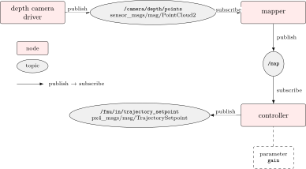
<figcaption>A ROS 2 graph. Nodes never call each other: they publish to
and subscribe from named, typed topics. A node can expose parameters
such as a gain.</figcaption>
</figure>

## QoS: why PX4 topics need special settings

Quality of Service (QoS) settings decide how messages are delivered. A
publisher and a subscriber only connect if their settings are
*compatible*. The two settings that matter here:

- **Reliability**: *reliable* resends lost messages; *best effort* does
  not. Sensor streams use best effort, since a late old sample is worse
  than a lost one.

- **Durability**: *volatile* sends only to subscribers present at
  publish time; *transient local* keeps the last message for late
  subscribers.

The ROS 2 default for a subscriber is reliable and volatile. PX4 does
not use these defaults, so a default subscriber to a PX4 topic can
silently receive nothing, which is the most common beginner failure. The
PX4 documentation says subscribers &ldquo;must specify a appropriate
(compatible) QoS setting&rdquo; and uses the predefined sensor-data
profile (`rmw_qos_profile_sensor_data`: best effort, volatile, small
queue) for PX4 output topics; its example sets a depth of 5. The guide
gives no per-topic settings, so use that profile for every PX4 topic.
Publishers to `/fmu/in/` need no special QoS: the ROS 2 default is
compatible. If a subscription shows no data, check with
`ros2 topic info -v <topic>`, which prints the QoS of each endpoint.

## Workspaces and colcon

Your code lives in a *workspace*: a folder with a `src/` directory.
`colcon` builds every package in `src/`.

``` bash
source /opt/ros/jazzy/setup.bash
cd ~/my_repo
colcon build --packages-select px4_msgs     # build one package
source install/setup.bash                   # make the result visible
```

Colcon creates `build/`, `install/` and `log/`. Never edit them and
never commit them. The order matters: first source the ROS base install
(the *underlay*), then build, then source `install/setup.bash` (the
*overlay*) in every new terminal where you want to run your packages.
Build only what you changed with `--packages-select`; large packages can
be slow to compile.

<figure>
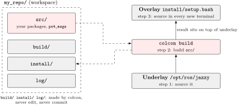
<figcaption>Your sources live in <code>src/</code>; colcon creates
<code>build/</code>, <code>install/</code> and <code>log/</code>. Source
the underlay, build, then source the overlay.</figcaption>
</figure>

## Command line tools

``` bash
ros2 topic list                              # all topics
ros2 topic info /fmu/out/vehicle_status -v   # type and QoS (name may differ)
ros2 topic echo <topic>                      # print messages
ros2 topic hz <topic>                        # publication rate
ros2 interface show px4_msgs/msg/TrajectorySetpoint   # message fields
ros2 node list                               # running nodes
ros2 param list /my_node                     # parameters of a node
ros2 launch <package> <file>.launch.py       # start a launch file
rqt_graph                                    # picture of nodes and topics
rviz2                                        # 3D view: clouds, maps, paths
```

Before you use a message field, check its name with
`ros2 interface show`. If two people on one network see each
other&rsquo;s topics by accident, set a different `ROS_DOMAIN_ID` (0 to
101) in each terminal.

<figure>
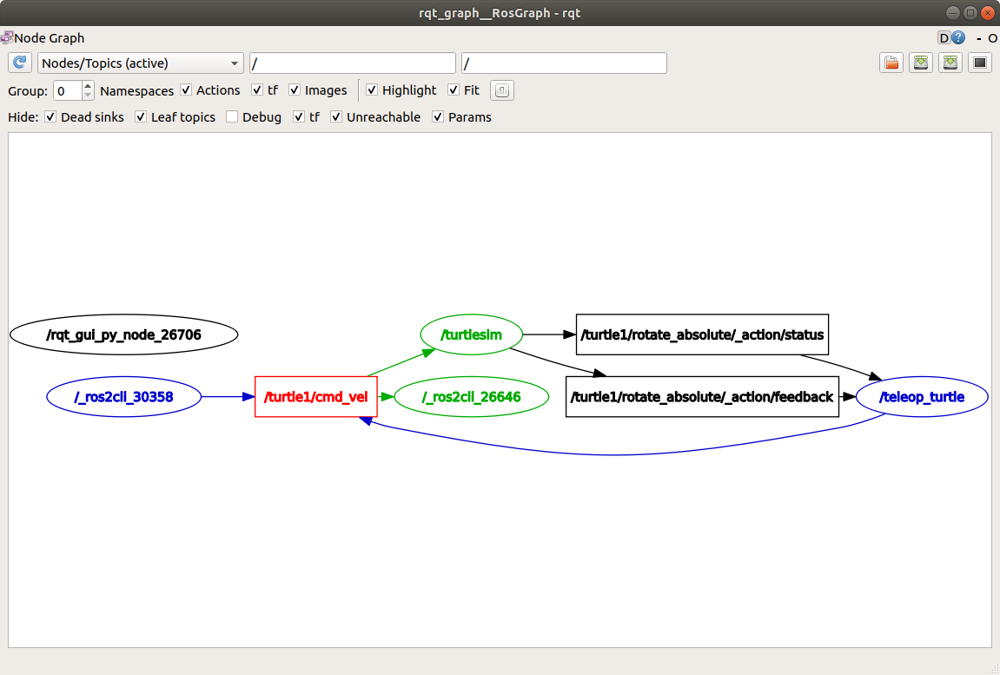
<figcaption><code>rqt_graph</code> draws the live graph: here the
turtlesim nodes and the <code>/turtle1/cmd_vel</code> topic. Image: ROS
2 Documentation (Jazzy), CC BY 4.0.</figcaption>
</figure>

## A minimal node

A subscriber in Python (`rclpy`) that prints the north position from
PX4, with a compatible QoS. The field `x` exists in
`px4_msgs/msg/VehicleLocalPosition`; it is the north position in the NED
frame, in metres (checked in the `msg` folder of `px4_msgs`). The topic
name must be checked with `ros2 topic list` ([PX4](#px4)).

``` python
import rclpy
from rclpy.node import Node
from rclpy.qos import qos_profile_sensor_data
from px4_msgs.msg import VehicleLocalPosition

class Echo(Node):
    def __init__(self):
        super().__init__("echo")
        self.create_subscription(
            VehicleLocalPosition, "/fmu/out/vehicle_local_position",
            self.cb, qos_profile_sensor_data)

    def cb(self, msg):
        self.get_logger().info(f"north = {msg.x:.2f} m")

rclpy.init()
rclpy.spin(Echo())
```

Run it with `python3 echo.py` in a terminal where both ROS and the
workspace are sourced. C++ nodes (`rclcpp`) have the same structure:
create the node, create subscriptions and publishers, spin.

# PX4

## Architecture

PX4 is the flight-controller firmware. It runs on the flight-controller
board (or, in simulation, as a normal program on your PC). It reads the
IMU and other sensors, estimates the vehicle state (with an EKF), and
runs the control loops that turn setpoints into motor commands. Inside
PX4, modules communicate through **uORB**, a publish/subscribe system
like ROS topics but internal to the firmware. PX4 does not run ROS. A
bridge ([uXRCE-DDS bridge](#the-uxrce-dds-bridge)) copies chosen uORB
topics to ROS 2.

<figure>
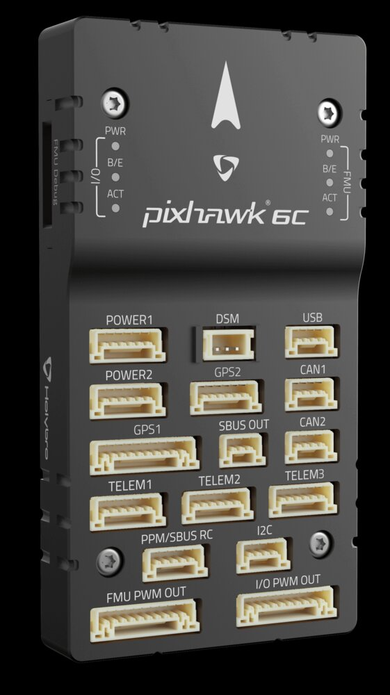
<figcaption>A flight-controller board (Holybro Pixhawk 6C) with its
ports. PX4 runs on it. Image: PX4 User Guide (Holybro), CC BY
4.0.</figcaption>
</figure>

Control is hierarchical. Your controller outputs a setpoint, for example
an acceleration. PX4&rsquo;s position and velocity controllers turn it
into an attitude and thrust setpoint; the attitude and rate loops close
the rest at a much higher rate. This is why a high-level planner can
often treat the vehicle as a point mass: the fast inner loops are
PX4&rsquo;s job.

<figure>
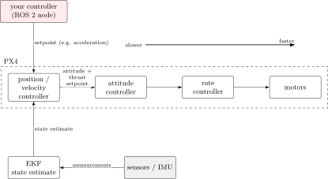
<figcaption>Control hierarchy. Your node sends a setpoint; PX4&#x2019;s
position, attitude and rate loops, each faster than the last, turn it
into motor commands. The EKF feeds the state estimate back to the
position controller.</figcaption>
</figure>

## Flight modes and offboard mode

A flight mode decides who produces the setpoints. Manual and stabilised
modes follow the pilot&rsquo;s sticks. Position mode holds position.
Hold, Return and Land are automatic. **Offboard** mode follows setpoints
that arrive from an external computer, which is your ROS 2 node.

Rules for offboard mode, from the PX4 documentation:

- PX4 must *already receive* `OffboardControlMode` messages before it
  accepts offboard mode or arms in it. Start the stream first.

- `OffboardControlMode` must be sent together with a setpoint message
  (for example `TrajectorySetpoint`). The first message says *which*
  fields are used; the second carries the values.

- If the stream of `OffboardControlMode` drops below about 2 Hz, PX4
  leaves offboard mode (failsafe). Send both at a steady rate well above
  that. The official example uses a 100 ms timer (10 Hz); 50 Hz or more
  is common.

- The official example sends 10 setpoints, then requests the mode
  switch, then arms.

<figure>

<figcaption>Offboard timeline: stream first, then request offboard mode
and arm. If the stream drops below about 2&#x2006;Hz, PX4 leaves offboard
mode.</figcaption>
</figure>

The three messages (fields checked in the `msg` folder of `px4_msgs`):

- `OffboardControlMode`: `timestamp` and the booleans `position`,
  `velocity`, `acceleration`, `attitude`, `body_rate`,
  `thrust_and_torque`, `direct_actuator`. For acceleration control set
  `acceleration = true` and the others false.

- `TrajectorySetpoint`: `timestamp`, `position``[``3``]`,
  `velocity``[``3``]`, `acceleration``[``3``]`, `jerk``[``3``]`, `yaw`,
  `yawspeed`. In NED, metres and seconds. Set every field you do not
  control to NaN: the message file says NaN means &ldquo;the state
  should not be controlled&rdquo;. For example, to command an
  acceleration, set `acceleration` and leave `position` and `velocity`
  NaN.

- `VehicleCommand`: `command`, `param1`, `param2`, &mldr;,
  `target_system`, `target_component`, `source_system`,
  `source_component`, `from_external`. Arm with the command
  `VEHICLE_CMD_COMPONENT_ARM_DISARM` (400), `param1 = 1`. Switch mode
  with `VEHICLE_CMD_DO_SET_MODE` (176); the official example uses
  `param1 = 1` and `param2 = 6` for offboard.

To see the current mode, read `VehicleStatus`: its `nav_state` equals
`NAVIGATION_STATE_OFFBOARD` (14) and `arming_state` equals
`ARMING_STATE_ARMED` (2) when all is well.

## The uXRCE-DDS bridge

PX4 talks to ROS 2 through the Micro XRCE-DDS protocol. A *client* runs
inside PX4 and an *agent* runs on the companion computer (or the PC in
simulation). The agent exposes the PX4 topics as ROS 2 topics under the
prefix `/fmu/`: PX4 output under `/fmu/out/`, input under `/fmu/in/`.
Start it for the simulator:

<figure>
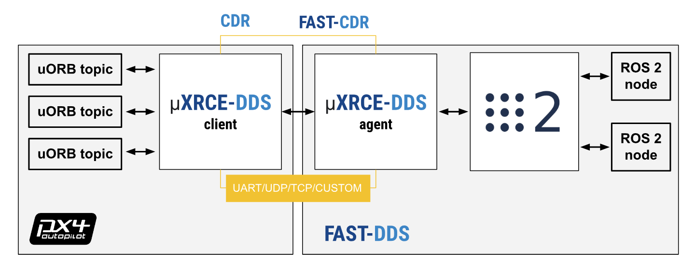
<figcaption>The uXRCE-DDS bridge: the client in PX4 talks to the agent,
which exposes uORB topics as ROS 2 topics. Image: PX4 User Guide, CC BY
4.0.</figcaption>
</figure>

``` bash
MicroXRCEAgent udp4 -p 8888
```

The PX4 ROS 2 guide uses this command. On the real drone the link is a
serial line. On our drone the agent runs as
`MicroXRCEAgent serial --dev /dev/ttyTHS1 -b 921600`, and PX4 has
`UXRCE_DDS_CFG = TELEM2` at 921600 baud. Expect names such as
`/fmu/in/offboard_control_mode`, `/fmu/in/trajectory_setpoint`,
`/fmu/in/vehicle_command`. Since PX4 1.16 some messages are versioned
(the `MESSAGE_VERSION` constant in the `.msg` files), which may add a
suffix to the topic name. Always run `ros2 topic list` and use what you
see.

**px4_msgs must match the firmware.** The bridge sends messages as raw
binary. If the field layout in your ROS 2 package differs from the one
compiled into the firmware, data is misread or dropped. Pin
`src/px4_msgs` to the release branch of your firmware (`release/1.17`
for PX4 1.17, see [Submodules](#submodules)). If the firmware changes,
change the submodule with it, and rebuild with
`colcon build --packages-select px4_msgs`.

## Frames: NED/FRD versus ENU/FLU

PX4 and ROS use different frame conventions, and mixing them up is the
most common source of bugs.

<figure>

<figcaption>World frames seen from above. In ENU the third axis points
up; in NED it points down. The north and east axes swap places. Body
frames are FLU (ROS: forward, left, up) and FRD (PX4: forward, right,
down).</figcaption>
</figure>

|  | ROS (REP-103) | PX4 |
|:---|:---|:---|
| World frame | ENU: $`x`$ East, $`y`$ North, $`z`$ Up | NED: $`x`$ North, $`y`$ East, $`z`$ Down |
| Body frame | FLU: $`x`$ forward, $`y`$ left, $`z`$ up | FRD: $`x`$ forward, $`y`$ right, $`z`$ down |

Consequences:

- Altitude is $`-z`$ in PX4. Flying 2 m above the ground means $`z=-2`$
  in the `position` of `TrajectorySetpoint` and in
  `VehicleLocalPosition.z`. A positive $`z`$ setpoint drives the drone
  into the floor.

- World vectors convert ENU to NED by swapping $`x`$ and $`y`$ and
  negating $`z`$: $`(x_E,y_N,z_U)\mapsto(y_N,x_E,-z_U)`$. The PX4 docs
  describe it as a rotation of $`\pi/2`$ about $`Z`$ then $`\pi`$ about
  $`X`$.

- Body vectors convert FLU to FRD (and back) by negating $`y`$ and $`z`$
  (a rotation of $`\pi`$ about $`X`$).

- Yaw: PX4 yaw is measured from North, positive clockwise seen from
  above; ROS yaw is measured from East, positive counter-clockwise. A
  conversion is needed here too.

The PX4 docs recommend the helper functions in `px4_ros_com`
(`frame_transforms`). Decide once, in your project, in which frame each
node works and convert only at the PX4 boundary. Many ROS nodes use ENU
internally; the setpoint is then converted to NED just before
publishing. An acceleration setpoint is a world-frame acceleration, so
the same $`x\leftrightarrow y`$, $`z\to-z`$ rule applies to it.

## Simulation: SITL with Gazebo

SITL (software in the loop) runs the real PX4 firmware as a program on
your PC, with Gazebo (`gz`) simulating the drone and the world. You need
your own PX4-Autopilot checkout in `~/PX4-Autopilot`, at tag `v1.17.0`
(not part of your project repo; see [Installing the other
tools](#installing-the-other-tools)). The make targets from the PX4 docs
are:

``` bash
cd ~/PX4-Autopilot        # path is machine-specific
make px4_sitl gz_x500                 # plain x500 quadrotor
make px4_sitl gz_x500_depth           # x500 with a front depth camera
make px4_sitl gz_x500_lidar_2d        # x500 with a 2D LiDAR
```

These three targets are listed in the PX4 Gazebo page (main
documentation). A world is chosen by appending its name to the target or
with the environment variable `PX4_GZ_WORLD`. The first build takes
several minutes. Simulated sensor images and point clouds reach ROS 2
through a Gazebo-ROS bridge (package `ros_gz_bridge`); the topic names
depend on the model.

<figure>
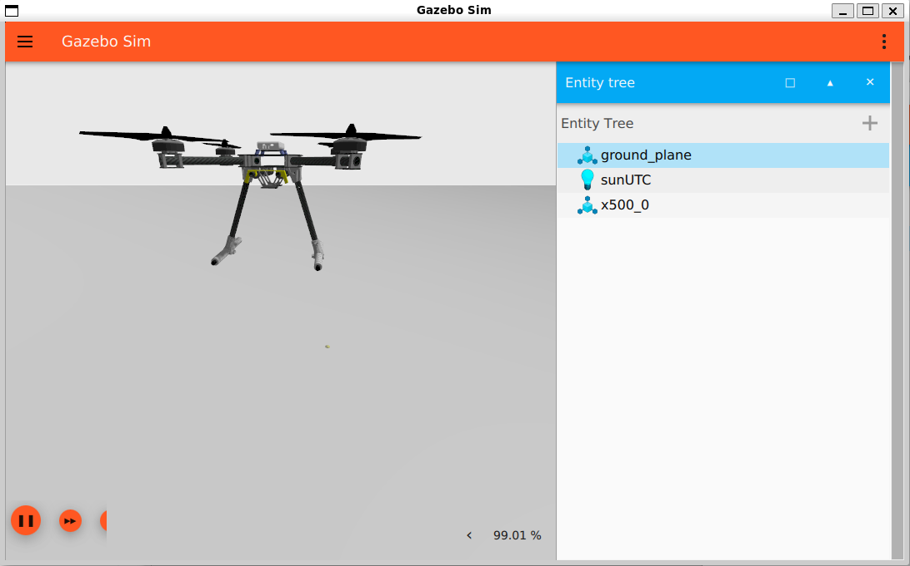
<figcaption>Gazebo with the x500 quadrotor, as started by
<code>make px4_sitl gz_x500</code>. Image: PX4 User Guide, CC BY
4.0.</figcaption>
</figure>

## QGroundControl, parameters and safety

**QGroundControl** (QGC) is the ground-station program. It shows the
vehicle state, lets you arm, change the flight mode, read and write PX4
*parameters*, and load failsafe settings. In simulation it connects
automatically. Parameters are named values stored in the firmware (for
example the one that enables the XRCE-DDS client). Change them in QGC
under *Vehicle Setup -\> Parameters*. Some need a reboot. Never change a
parameter on the real drone without knowing what it does.

<figure>
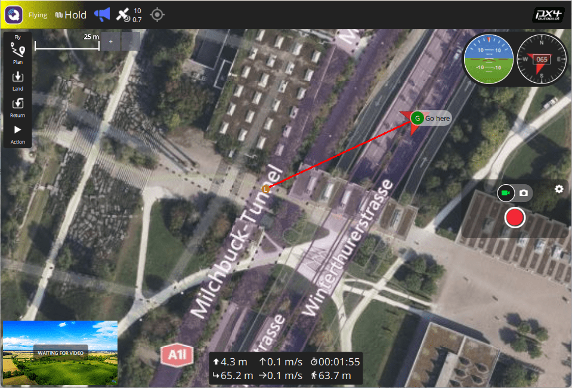
<figcaption>QGroundControl fly view: map, flight mode, attitude and
arming. Image: PX4 User Guide, CC BY 4.0.</figcaption>
</figure>

<figure>
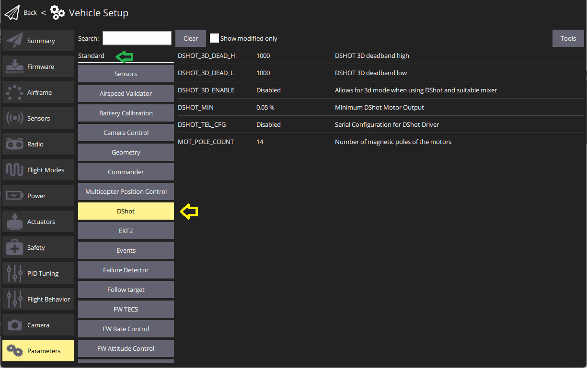
<figcaption>QGroundControl parameter editor (<em>Vehicle Setup -&gt;
Parameters</em>). Image: PX4 User Guide, CC BY 4.0.</figcaption>
</figure>

**Safety in the flight cage.** Follow every rule below on every flight.

- Fly in the cage with a safety pilot holding the radio transmitter. Be
  able to leave offboard mode with one switch and take manual control.

- Know the **kill switch**: it stops the motors at once. The drone
  falls. Use it only when the alternative is worse. Find its channel in
  QGC: the parameter `RC_MAP_KILL_SW` shows it. Ask the safety pilot
  which physical switch that is.

- Test everything in simulation first. Then fly low and slow, with props
  on only for a planned flight. Remove propellers when working on the
  bench.

- If the setpoint stream stops, PX4 leaves offboard mode (see above). On
  our drone it then lands (PX4 parameter `COM_OBL_RC_ACT`).

# How it fits together

<figure>
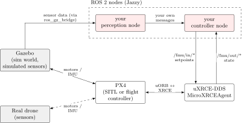
<figcaption>Data flow. Grey: the simulator or hardware. White: PX4 and
its bridge. Red: your ROS 2 nodes. On the real drone, sensors reach your
perception node through their own ROS 2 driver (an Intel RealSense with
<code>realsense2_camera</code>), in place of the Gazebo
bridge.</figcaption>
</figure>

The sensor produces data. Your perception node turns it into something
the controller can use. Your controller node reads the vehicle state
from PX4 (through the bridge), computes a command, and publishes an
`OffboardControlMode` and a `TrajectorySetpoint`, as in [PX4](#px4), and
PX4 flies it. In simulation, Gazebo plays the part of the real world,
and your nodes run the same way.

## First-day checklist

Run these one at a time and read the output. Paths in angle brackets are
yours.

- [ ] Check the system: `lsb_release -a` (expect Ubuntu 24.04) and
  `ls /opt/ros` (expect `jazzy`). No `jazzy`? Install it first
  ([Installing ROS 2 Jazzy](#installing-ros-2-jazzy)).

- [ ] Get GitHub access and an SSH key. Test: `ssh -T git@github.com`.

- [ ] Clone with submodules:
  `git clone --recursive git@github.com:<owner>/<repo>.git`

- [ ] Check the submodules: `cd <repo> && git submodule status`. No line
  may start with `-`. If one does:
  `git submodule update --init --recursive`.

- [ ] Source ROS and build the messages:
  `source /opt/ros/jazzy/setup.bash && colcon build --packages-select px4_msgs`,
  then `source install/setup.bash`.

- [ ] Check a message:
  `ros2 interface show px4_msgs/msg/OffboardControlMode`.

- [ ] Read the project README and the open issues on GitHub.

- [ ] Set up PX4 SITL: clone PX4-Autopilot at tag `v1.17.0` into
  `~/PX4-Autopilot` ([Installing the other
  tools](#installing-the-other-tools)), then in terminal 1:
  `make px4_sitl gz_x500`.

- [ ] Terminal 2: `MicroXRCEAgent udp4 -p 8888`.

- [ ] Terminal 3: source ROS and the workspace, then `ros2 topic list`.
  You should see topics under `/fmu/`. Check that one publishes:
  `ros2 topic hz <topic>`.

- [ ] Open QGroundControl and check that it shows the simulated vehicle.

- [ ] Hover the simulated drone in offboard mode with the example from
  the PX4 offboard control page
  (`docs.px4.io/main/en/ros2/offboard_control.html`). Follow that page
  for how to build and run it.

- [ ] Open a branch for your first task and push it:
  `git switch -c docs/1-first-day`.

# Further reading

- Linux command line:
  [ubuntu.com/tutorials/command-line-for-beginners](https://ubuntu.com/tutorials/command-line-for-beginners)

- Pro Git book: [git-scm.com/book](https://git-scm.com/book) (chapters
  1-3 and 7.11 &ldquo;Submodules&rdquo;)

- GitHub docs: [docs.github.com](https://docs.github.com)

- ROS 2 Jazzy documentation and tutorials:
  [docs.ros.org/en/jazzy](https://docs.ros.org/en/jazzy)

- ROS 2 Jazzy install on Ubuntu:
  [docs.ros.org/en/jazzy/Installation/Ubuntu-Install-Debs.html](https://docs.ros.org/en/jazzy/Installation/Ubuntu-Install-Debs.html)

- REP-103 (units and frame conventions):
  [www.ros.org/reps/rep-0103.html](https://www.ros.org/reps/rep-0103.html)

- PX4 user and developer guide: [docs.px4.io](https://docs.px4.io) (use
  the page for version 1.17)

- PX4 ROS 2 user guide and offboard example:
  [docs.px4.io/main/en/ros2/user_guide.html](https://docs.px4.io/main/en/ros2/user_guide.html),
  [docs.px4.io/main/en/ros2/offboard_control.html](https://docs.px4.io/main/en/ros2/offboard_control.html)

- PX4 Gazebo simulation:
  [docs.px4.io/main/en/sim_gazebo_gz/](https://docs.px4.io/main/en/sim_gazebo_gz/)

- Message definitions:
  [github.com/PX4/px4_msgs](https://github.com/PX4/px4_msgs)

- Micro XRCE-DDS Agent:
  [github.com/eProsima/Micro-XRCE-DDS-Agent](https://github.com/eProsima/Micro-XRCE-DDS-Agent)

- QGroundControl user guide:
  [docs.qgroundcontrol.com](https://docs.qgroundcontrol.com)

- Gazebo: [gazebosim.org/docs](https://gazebosim.org/docs)
